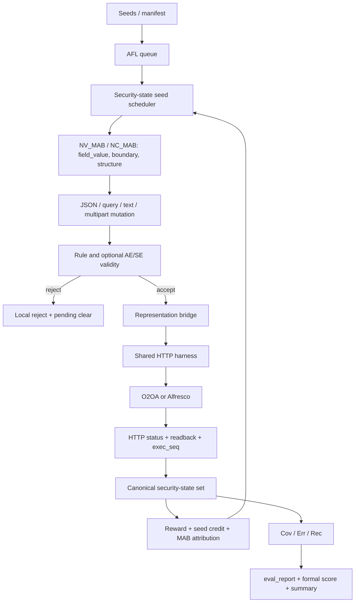

# Task 4 模糊测试组件：最终独立技术审计与双平台可复现实验指南

> 项目：河南重大专项 / 基于模糊测试的内生安全性能测评组件  
> 审计日期：2026-10-17（Asia/Shanghai）  
> 仓库：`/home/cphzy/AFL-`，分支 `main`  
> 权威基线提交：`d1a2c5db454b78cb4034f4f8da4778e12c514871`  
> 工作树：`DIRTY_EXPECTED`；本审计没有 reset、stash、clean、restore、revert、rebase、commit 或 push  
> 审计原则：以当前源码、测试、配置、原始 evidence 和冻结包为事实源，不沿用旧会话结论。

## 1. 独立结论

本审计认为，用户负责的 Task 4 模糊测试技术范围已由当前代码、测试、O2OA 正式验收、Alfresco 跨平台实证和双平台复现实验入口覆盖。结论不是“全部仓库测试均绿”或“所有科研/课题成果均已验收”：当前机器缺少 Alfresco 真实服务凭据和部分模型依赖，部分旧证据只保存了冻结汇总而非可迁移原始目录，任务控制 API 也不是两平台正式实验的规范调度入口。这些限制均在第 25 节逐项记录，但不构成正式 Task 4 技术能力缺失。

```text
REPOSITORY_AUDIT = PASS
USER_SCOPE_FUZZING_COMPONENT_COMPLETE = YES
TASK4_TECHNICAL_REQUIREMENTS_COMPLETE = YES
PROJECT_LEVEL_REQUIREMENTS = UNVERIFIED
FINAL_PROJECT_TECHNICAL_VERDICT = COMPLETE_WITH_DOCUMENTED_LIMITATIONS
FLOWABLE_REQUIRED_FOR_USER_SCOPE_COMPLETION = NO
```

项目级论文、专利、综合工具第三方验收及其他课题组模块在仓库内没有足够事实可核验，故总体标为 `UNVERIFIED`；其中不属于用户承担范围的单项应理解为 `OUT_OF_USER_SCOPE`，不能反向把本组件判为未完成。

### 1.1 五项顶层技术判断

| 判断项 | 结论 | 核心依据 |
|---|---:|---|
| `EVALUATION_MODEL_IMPLEMENTED` | YES | security-state proxy Cov、Err、Rec 和三项综合评分均有代码、字段与测试 |
| `HIGH_QUALITY_SEED_METHOD_IMPLEMENTED` | YES | 扩展 queue 字段、覆盖贡献/选择次数概率、roulette、seed audit、新状态 credit、多 seed |
| `TESTCASE_GENERATION_METHOD_IMPLEMENTED` | YES | 三臂 MAB 与 JSON/query/text/multipart 语义变异，actual-arm 归因 |
| `FUZZING_EVALUATION_METHOD_IMPLEMENTED` | YES | validity → 实际 HTTP → readback/status → state → reward → report 完整闭环 |
| `RUNNABLE_COMPONENT_EXISTS` | YES | 可构建 `afl-fuzz`、规范 runner、两个最终一条命令入口 |

## 2. 范围、边界与平台角色

### 2.1 用户负责范围

`USER_OWNED_TECHNICAL_SCOPE` 是：评估模型、高质量种子与用例生成、自适应变异、有效性筛选、真实平台执行、security-state proxy 反馈、Cov/Err/Rec/综合评分、可运行组件、典型平台实证与复现实验。

以下属于 `PROJECT_LEVEL_DELIVERABLES`，本仓库不能完成最终行政核验：研究报告签章、论文数量/检索状态、专利申请/授权、整个综合工具的第三方测试、Task 5 差分测试/烈度测试及其他课题组模块。它们的状态如下。

| 项目级成果 | 本次状态 | 原因 |
|---|---|---|
| Task 4 技术代码与实验 | VERIFIED | 本文逐项追踪到代码、测试和实证 |
| 课题研究报告正式归档 | UNVERIFIED | 仓库文档不能替代课题管理系统/签章验收 |
| 论文数量与发表/检索 | OUT_OF_USER_SCOPE / UNVERIFIED | 非用户负责代码交付，仓库也不足以核验 |
| 专利数量与法律状态 | OUT_OF_USER_SCOPE / UNVERIFIED | 需官方专利与项目记录 |
| 综合工具第三方验收 | UNVERIFIED | 无完整第三方验收原件 |
| Task 5、差分/烈度测试 | OUT_OF_USER_SCOPE | 不属于本次 Task 4 模糊测试组件 |

### 2.2 O2OA、Alfresco 与 Flowable

- O2OA 9.5.2 是正式电子政务业务场景：URL query、电子公文创建/保存、数据更新、权限与清理均有正式证据。
- Alfresco 是跨平台工程深度验证：metadata、raw content、multipart 三种 representation 证明框架不依赖 O2OA。
- Flowable 是历史阶段目标。当前正式合同、当前 O2OA 冻结验收映射及最终入口契约均没有把它列为完成条件；因此不扩展、不重跑，`FLOWABLE_REQUIRED_FOR_USER_SCOPE_COMPLETION = NO`。

## 3. 审计方法与仓库事实

审计先核验分支、HEAD、预期脏工作树和 `git diff --check`，再读取源码而非仅仅读旧总结；随后校验 O2OA 冻结包 SHA256，抽查 R1/R2/R3/cleanup 原始证据，搜索 Alfresco 最新代码、测试和证据，现场构建与运行测试，最后新建 post-freeze 复现根。

本任务开始前已存在并被保留的变更包括 `nv_body_valid.py`、`nv_http_harness.py`、`nv_json_mutator.py`、`nv_url_query.py`、O2OA target/rules，以及 O2OA 输入和测试文件。它们是接受的 `DIRTY_EXPECTED` 状态，不是本任务创建。本任务只新增：

- `docs/TASK4_FINAL_TECHNICAL_AUDIT_AND_EXPERIMENT_GUIDE.md`
- `scripts/run_task4_o2oa_final_experiment.sh`
- `scripts/run_task4_alfresco_final_experiment.sh`

没有改测试，没有 commit/push。

## 4. 正式需求追踪矩阵

| Requirement | 正式要求 | 当前实现 | 主要证据 | 状态 | 说明 |
|---|---|---|---|---|---|
| 评估模型 | 基于模糊测试量化内生安全 | `src/afl-fuzz-run.c`、`src/afl-fuzz-stats.c`、正式 score 脚本 | O2OA 新复现、Alfresco accepted evidence | PASS | Cov 是工程归一化的 security-state proxy 指标，不冒充 AFL edge 或内部状态全集覆盖率 |
| 高质量种子 | 覆盖贡献与历史选择动态调度 | `ss_calc_prob`、roulette、seed audit、new-state credit | 单元测试、R1/Alfresco ledger | PASS | `SEED_SCHEDULER=IMPLEMENTED` |
| 用例生成 | 分层语义变异、自适应策略 | 3 arms；JSON/query/text/multipart mutators | MAB journals、三平台 representation evidence | PASS | `MULTI_SEED=PASS`、`SEED_CREDIT=PASS` |
| NC_MAB | 自适应选择变异组合 | 当前名称 NV_MAB，warm-up + UCB | `fuzzer_stats`、`mab_updates.jsonl` | PASS | 名称差异不改变算法要求 |
| 有效性筛选 | SE-fAnoGAN-ES 能力 | rule、AE、SE、32D extractor、UNIX RPC | tests、R50 SE 报告、Alfresco runner gates | PASS | 不要求证明 SE 胜 AE |
| 真实执行 | 对典型平台发送请求并监控 | 共享 `nv_http_harness.py` | O2OA/Alfresco 实证 | PASS | 非 curl-only 脚本 |
| 安全状态反馈 | 覆盖、异常、恢复、奖励闭环 | bounded covset、`exec_seq`、reward/MAB/seed credit | stats、state trace、journals | PASS | replay 不重复计数 |
| 报告与评分 | Cov/Err/Rec/Overall | `eval_report.json`、formal score | 新 O2OA summary | PASS | 权重由调用者显式给出 |
| O2OA 正式场景 | query/create/update、安全与清理 | 真实原生 API | 冻结包及外部原始 evidence | PASS | R2/R3 写场景不在默认复现中 |
| Alfresco 跨平台 | metadata/content/multipart | canonical bounded runner | accepted historical evidence、clean-HEAD tests | PASS | 本机 real rerun 被环境阻塞，不是代码失败 |
| 可重复入口 | 两平台一条命令、独立 evidence | 两个 `run_task4_*_final_experiment.sh` | 两平台 dry-run、新 O2OA real run | PASS | 入口能力通过；当前机器 Alfresco real rerun 为 `BLOCKED_ENVIRONMENT`，写场景会恢复/精确删除 |
| 技术总文档 | 足够独立部署、运行、审计 | 本文 | 章节 1–27 | PASS | 包含 API、配置、公式、故障排查 |

### 4.1 七步闭环逐步映射

| Step | 源文件/入口 | 输入 | 输出/关键状态 | 环境/配置 | Evidence | 完成 |
|---|---|---|---|---|---|---:|
| 1 初始化 | AFL queue、`nv_load_task_json` | seed dir、`task.json` | queue，`mutation_scope`，budget | `NV_TASK_PATH` | task/seed manifest | YES |
| 2 选高值种子 | `src/afl-fuzz-nv-sched.c:ss_calc_prob`、`src/afl-fuzz-queue.c` | `ss_cov_cnt`,`ss_selected_cnt` | roulette weight、selection JSONL | `NV_SEED_SELECTION_AUDIT_PATH` | `seed_selection.jsonl` | YES |
| 3 选策略/变异 | `src/afl-fuzz-nv-mab.c:nv_mab_pick`、`src/afl-fuzz-one.c`、custom mutators | enabled mask、历史 pulls/mean、seed | mutated bytes，selected/actual arm | `NV_MAB_C`,`NV_MAB_MIN_EXPLORE`,`NV_CUR_ARM` | MAB journal | YES |
| 4 有效性 | `nv_body_valid.py`、`model_stage/nv_valid_server_real.py` | scenario bytes、rules/model | accept/reject、score/trace | rules、`NV_VALID_SOCK`/score endpoint/threshold | valid stats、scorer trace | YES |
| 5 执行监控 | `nv_http_harness.py` | accepted bytes、target endpoint/auth | HTTP、readback/status、`exec_seq` | target JSON、credential env | status/ledger/readback | YES |
| 6 反馈更新 | `src/afl-fuzz-run.c`、covset/MAB/queue | fresh status | state insertion、reward、seed credit、MAB mean | state/status/journal paths | state trace、MAB/seed audit | YES |
| 7 报告评分 | `src/afl-fuzz-stats.c`、`compute_formal_security_score.py` | stats/counters | `fuzzer_stats`,`eval_report.json`, summary | β1/β2/β3 | frozen/new summaries | YES |

## 5. 实际总体架构与调用链



规范执行不是“入口脚本直接 curl”。O2OA 脚本调用编译后的 AFL++、Python custom mutator、规则过滤和共享 harness。Alfresco 脚本调用 `scripts/run_alfresco_bounded_feedback.py`；该 runner 再配置相同的 AFL/MAB/filter/harness/state/report 链，并做 scenario readback。最终 wrapper 额外承担外部基线快照、精确恢复/删除、凭据泄漏防护和统一 summary。

### 5.1 调用链的审计关键点

1. `src/afl-fuzz-one.c` 选 arm 后通过 `NV_CUR_ARM` 交给 Python mutator。
2. `nv_json_mutator.py` 把实际执行的 arm 写入 `NV_JSON_ARM_USED`；selected 与 actual 不同会记录 mismatch，不能领 reward。
3. validity reject 有 audit identity，但不会调用目标；pending 以 `invalid_input` 清理。
4. harness 原子写当前 status，并追加不可变 status/execution ledger；`exec_seq` 是重放身份。
5. C core 只接受比上次新的 `exec_seq`，将 METHOD/PATH/RESPONSE_CLASS 规范化并放入固定容量状态集合。
6. 新 state 同时给当前 seed credit，并作为 MAB reward 成分；budget 边界会显式清 pending。
7. native AFL coverage 与 security-state proxy coverage 分开输出。

## 6. 仓库结构与核心文件

```text
AFL-/
├── src/                         # AFL++ core + Task 4 scheduler/MAB/state/report 改造
├── include/afl-fuzz.h           # Task/MAB/security-state 数据结构与常量
├── nv_http_harness.py           # 共享 HTTP/认证/representation/status producer
├── nv_body_valid.py             # rule/AE/SE 路由及本地校验
├── nv_json_mutator.py           # JSON/multipart/query 相关 custom mutation/arm handshake
├── nv_text_mutator.py           # text/plain content mutation
├── nv_url_query.py              # URL query parse/serialize/mutation
├── model_stage/                 # 32D extractor、AE、SE reference、真实 scorer RPC
├── targets/                     # O2OA/Alfresco endpoint/auth/transport 配置
├── validity/                    # 按 scenario 的有效性规则
├── scripts/                     # runner、评分、最终两个用户入口
├── integration/                 # 任务函数 API 与轻量 HTTP server
├── tests/                       # unit/offline/mock/regression/acceptance tests
├── in/                          # seed corpus/manifest；含多 seed 数据集
├── out/                         # 历史/本地输出，不自动等同验收证据
├── runner/                      # 历史/辅助 runner 资产；最终入口以 scripts 为准
├── alfresco_multiinterface_expansion/ # Alfresco 持久化 evidence
└── docs/                        # 设计、交付、验收与本文
```

最关键的 AFL++ 扩展文件：

- `src/afl-fuzz-nv-sched.c`：Task 4 seed 权重。
- `src/afl-fuzz-nv-mab.c`：三臂选择、增量均值、pending 与审计 journal。
- `src/afl-fuzz-nv-covset.c`：状态 canonicalization、replay 判定、固定容量集合。
- `src/afl-fuzz-run.c`：消费 status、state accounting、reward 与 MAB commit。
- `src/afl-fuzz-stats.c`：stats 与 `eval_report.json`。
- `src/afl-fuzz-one.c`：选择策略、custom mutator 实际 arm 归因。
- `src/afl-fuzz-queue.c`：基于 Task 4 权重的 queue roulette 与 seed audit。
- `include/afl-fuzz.h`：三 arms、默认参数、reward 常量、字段定义。

## 7. AFL++ / Deep2Fuzz-ES 改造

原生 AFL++ 仍保留 edge bitmap、queue、calibration 和 custom mutator 机制；Task 4 在其上增加业务语义闭环，而非把 edge coverage 改名。

| 扩展 | 为什么需要 | 关键数据流 | 与原生 AFL++ 的区别 |
|---|---|---|---|
| task metadata/budget | 有界、可审计实验 | task → max cases/time/scope | 可按有效执行数终止 |
| state seed scheduler | 优先高安全状态贡献 seed | status → seed credit → weight | 不只按 edge/速度启发式 |
| NV_MAB | 自适应选择语义策略 | reward → pulls/mean → UCB | 非固定/havoc-only 策略 |
| representation mutators | 对业务输入保持 transport 可解释性 | seed → structured mutation | 支持 JSON/query/text/multipart |
| validity filter | 避免明显无效输入消耗真实平台 | rules/model → local reject | reject 不计目标执行、不领奖励 |
| status/exec_seq | 将一次 HTTP 与一次 fuzz iteration 唯一关联 | harness → status → core | 可识别重复读与旧 status |
| security-state set | 量化业务响应状态 | method/path/class → FNV1a64 | 与 edge bitmap独立 |
| reward attribution | 反馈到 arm/seed | ncov/state/exception/recovery/4xx | journal 可重算、actual arm gate |
| reports | 输出正式指标 | counters → stats/eval report | 新增 Cov/Err/Rec/MAB/validity |

## 8. 种子机制

### 8.1 格式与来源

- JSON：O2OA create/update、Alfresco metadata；输入是业务 body，不含认证秘密。
- query：如 `fileType=attachment`；序列化到 URL，request body 必须为空。
- raw text：Alfresco content update，UTF-8 `text/plain`。
- multipart：seed 描述 HTTP multipart envelope/file field，最终由 bridge 生成真实 multipart 请求。

`seed_source` 在 task/summary 中记录实际 seed 路径或 manifest。O2OA 当前正式输入位于 `in/o2oa_url_query/`；Alfresco datasets 和 bounded multipart corpus 位于 `in/alfresco_*`。

示例（非秘密）：

```text
query seed: fileType=attachment
metadata seed: {"properties":{"cm:title":"nv baseline","cm:description":"task4"}}
content seed: task4 bounded content
multipart semantic fields: filename=nv-task4.txt, filedata=<utf8>, nodeType=cm:content, autoRename=true
```

### 8.2 高价值选择

`src/afl-fuzz-nv-sched.c:ss_calc_prob` 的权重为：

\[
w_i=\max\left(0.01,\frac{ss\_cov\_cnt_i+1}{(ss\_selected\_cnt_i+1)^{0.7}}\right)
\]

`src/afl-fuzz-queue.c` 用该权重 roulette 选 queue entry，并把 `queue_id`、depth、`ss_cov_cnt`、`ss_selected_cnt`、weight/选择结果写入 `NV_SEED_SELECTION_AUDIT_PATH`。新安全状态会在 `src/afl-fuzz-run.c` 给当前 `queue_cur->ss_cov_cnt++`，并增加 `security_state_seed_credit`；因此这是 Task 4 扩展，而不是仅有原始 AFL queue。

多 seed 由普通 AFL input directory 原生装载，并通过 seed manifest/selection audit 证明每个条目的来源与被选情况。Alfresco multipart accepted run 使用 3 seed；代码与测试也覆盖多 seed 队列。

```text
SEED_SCHEDULER = IMPLEMENTED
MULTI_SEED = PASS
SEED_CREDIT = PASS
```

## 9. 三类变异策略与 representation 差异

| Arm | ID | 输入/算法 | 例子 | 失败处理 |
|---|---:|---|---|---|
| `field_value` | 0 | 改叶值、枚举、字符串内容 | `attachment` → `folder`；title 内容变化 | 不满足规则则 local reject |
| `boundary` | 1 | 空值、长度/数值边界、特殊字符 | `"abc"` → `""` 或最大允许长度 | 超出硬限制 reject；不发 HTTP |
| `structure` | 2 | 增删/重排字段、数组/对象结构 | properties 中受控增删字段 | required/allowlist 不满足则 reject |

实际适配：

- JSON：`nv_json_mutator.py` 解析树，保留可序列化 JSON；scenario profile 限制字段。
- query：`nv_url_query.py` 对 key/value/repeated value 操作，再 percent-encode；O2OA 正式 endpoint 的 allowlist 仅允许 `fileType=attachment|folder`。
- text：`nv_text_mutator.py` 对 UTF-8 内容做 field/boundary/structure 等价操作，规则限定非空、无二进制、最大 4096 字符。
- multipart：语义字段被变异，再由 harness/runner 构造边界和 `filedata`；规则约束 `.txt`、UTF-8、无 NUL、`nodeType=cm:content`、`autoRename=true`。
- HTTP envelope：历史/离线完整 HTTP seed可由 bridge 解析；正式 runner 不允许 mutation 破坏认证或越过 target allowlist。

“字段顺序变化、空/超长/特殊字符串、数值边界/异常值、非法枚举”作为 mutation 能力存在，但正式 live 实验还必须经过 scenario rule/model；能生成不等于会被允许发送。

## 10. NV_MAB / NC_MAB

正式方案名为 NC_MAB；当前代码实体叫 NV_MAB。它有完全一致的自适应职责，不以命名差异判缺失。

### 10.1 选择算法

默认探索系数 `c=0.05`，每个 enabled arm 默认 warm-up `min_explore=8`。优先级为：有效环境变量 `NV_MAB_C`/`NV_MAB_MIN_EXPLORE` > task JSON > 编译默认；空白、非法、越界值不会屏蔽下一层。

warm-up 每次选 pulls 最少的 enabled arm，平局选最低 ID，直至每臂达到 `min_explore`。之后：

\[
UCB_a=meanReward_a+c\sqrt{\frac{\ln(totalPulls+1)}{pulls_a}}
\]

选最大 UCB。update 使用在线均值：

\[
mean'_a=mean_a+\frac{reward-mean_a}{pulls'_a}
\]

### 10.2 奖励

`src/afl-fuzz-run.c:nv_reward_from_obs`：

\[
R=1000\cdot ncov\_delta+10\cdot newStates+5\cdot exception+2\cdot recovered-0.1\cdot is4xx
\]

这里 `ncov_delta` 是 harness/native coverage 信号；`newStates` 是 security-state 新状态。journal 分别保存各 reward component，避免只留总分。

### 10.3 归因和边界

- `selected_arm` 来自 C core；`actual_used_arm` 来自 custom mutator handshake。
- 不匹配：`arm_mismatch`，不 commit reward。
- validity reject：`invalid_input`，清 pending，不计目标执行。
- 缺/旧 `exec_seq`：`invalid_exec_identity`，不允许不可核验奖励。
- 正常执行：journal 写 `exec_seq`、pulls/sum before/after、mean、positive count、reward components。
- 达到 budget：`budget_boundary` 清 pending，不能留下幽灵 pull。

输出实际字段包括 `nv_mab_total_pulls`、`nv_mab_arm{0,1,2}_pulls`、`nv_mab_arm{0,1,2}_mean`、`nv_mab_arm{0,1,2}_sum`、`nv_mab_pending`、`selected_arm`、`actual_used_arm`、`arm_match`。

## 11. Validity Filter

```text
VALIDITY_FILTER_EXISTS = YES
RULE_FILTER_EXISTS = YES
AE_BACKEND_EXISTS = YES
SE_BACKEND_EXISTS = YES
SE_REAL_SCORER_PARTICIPATION = PASS (accepted historical R50 evidence)
```

### 11.1 三层能力

1. Rule-only：`nv_body_valid.py` 读取 scenario rules，检查最大字节/深度/键数/字符串、required、allow_unknown、enum，以及 text/multipart 专用约束。
2. AE：`model_stage/alfresco_ae_v1_scorer.py` 与 `alfresco_ae_v1_meta.json` 使用共享 32D 特征、训练统计 z-score/RMS 和 `threshold_high`。
3. SE：`model_stage/sefanogan_es_reference.py` 提供 WGAN-GP/attention encoder reference scorer，同样消费 32D 特征；`nv_valid_server_real.py` 根据 scenario/backend 路由真实 scorer。

`model_stage/alfresco_feature_extractor.py` 是 metadata/content/multipart 共享 extractor。32D 表示包含结构/长度/字符/字段等 scenario-aware 统计，先按模型 metadata 保存的训练均值/尺度归一化，再产生 anomaly score，与配置 threshold 比较。

RPC 使用 UNIX socket、长度前缀 JSON envelope 和 base64 body；相关变量是 `NV_VALID_SOCK` 或 `NV_BODY_SCORE_ENDPOINT=unix://...`、`NV_BODY_SCORE_THRESHOLD`、`NV_VALIDITY_BACKEND`、`NV_SCORER_TRACE_PATH`。canonical Alfresco model-comparison runner对 scorer 启动、参与次数和 artifact 做验收 gate。

### 11.2 Fail-closed 的精确结论

不能用一个不加限定的 YES 掩盖代码事实：

- multipart 显式 score RPC 失败会 reject；model-comparison 的启动/参与/artifact 验收是 fail-closed。
- 但 `nv_body_valid.py` 的 JSON/text request-level RPC 异常存在 fail-open 路径（返回 rule 合法），因此全局逐输入意义下 `FILTER_FAIL_CLOSED = NO`。
- campaign acceptance 意义下，canonical model-comparison gate 为 `FILTER_FAIL_CLOSED = YES`：scorer 没真实参与不能得到 PASS。

形式化要求是“具备 SE-fAnoGAN-ES 筛选能力”，不是“SE 必须胜过 AE”。R50 报告证明 content scenario 有 6 次 scorer RPC 成功、2 次 HTTP 200、2 次 MAB update、readback PASS，9 次 trace invocation 全成功；但其 `/tmp` 原始目录已不存在，所以它是保留报告级而非完整可迁移原始证据。另一个已知实现限制是通用 `predict_score_from_body` 对 content+AE 的路由不如 scorer class 完整，见第 25 节。

## 12. HTTP / Representation Bridge

| Representation | 输入如何转换 | 正式使用 |
|---|---|---|
| body-only JSON | mutation bytes 作为 JSON body，method/path/auth 来自 target config | O2OA create/update、Alfresco metadata |
| URL query | parse/validate/percent-encode 后拼接到固定 path；body length 为 0 | O2OA R1/default final experiment |
| raw/text | bytes 作为 `text/plain; charset=utf-8` PUT content | Alfresco content |
| multipart | 语义字段/HTTP seed解析后构造 `multipart/form-data` 与 filedata | Alfresco upload |
| HTTP envelope | method/path/header/body 拆分；目标/认证仍受 config allowlist | 离线与历史 multipart路径 |

认证材料从环境在 harness 内加入，不进入 seed、mutation 或 summary。O2OA harness 用 `urllib` 的空 `ProxyHandler({})`，最终 wrapper 还清理 proxy 环境并做 direct health；Alfresco Basic 凭据不写 artifact。

## 13. Security-State Coverage

### 13.1 与 AFL edge coverage 的区别

AFL edge coverage 是 harness/被插桩目标的控制流 bitmap。本文实现中的 security-state 是基于外部业务接口可观测行为构造的“安全状态代理（security-state proxy）”：它用于稳定、可重放地量化测试过程中可区分的业务安全响应状态，不宣称穷举目标系统内部所有安全机制状态，也不等价于系统理论安全状态全集。`eval_report.json` 将 AFL edge coverage 与该代理覆盖分开；Task 4 的正式 Cov 取后者。

```text
AFL edge coverage != security-state proxy coverage
security-state proxy coverage != complete internal security-state coverage
```

以下继续沿用实现和 artifact 的既有字段名 `security_state_*`；“proxy”是对其工程语义边界的精确说明，不重命名代码或输出 schema。

状态文本定义：

```text
METHOD SPACE PATH | RESPONSE_CLASS
state_id = fnv1a64(canonical_text)
```

method 只允许 GET/POST/PUT/PATCH/DELETE/HEAD/OPTIONS，否则折叠为 `INVALID`；response class 是 2xx/3xx/4xx/5xx/conn_refused/timeout，否则 `other`；不可用 path 折叠到固定标签。随后状态放入固定容量（生产默认 65536）的 open-addressed linear-probing set；饱和时丢弃并计数，绝不把丢弃状态伪装为 new/reward。

当前 allowed-path 匹配对带 query 的 status path 会折叠为 `unknown_path`，因此 O2OA query 的两个状态主要由不同 response-class/path canonicalization 结果产生；这不影响执行真实性，但降低 path 维度分辨率，是已记录限制。

### 13.2 计数字段

| 字段 | 含义 |
|---|---|
| `security_state_total` | set 当前唯一状态数 |
| `security_state_new_total` | 首次发现累计数 |
| `security_state_delta_last` | 最近消费 status 带来的新状态数 |
| `security_state_observations` | fresh observations 总数 |
| `security_state_seed_credit` | 因新状态给当前 seed 的 credit 次数 |
| `security_state_capacity` | set 容量 |
| `security_state_saturated/dropped` | 饱和及丢弃计数 |
| `security_state_replays` | 重复/旧 status 次数 |
| `security_state_reward_src_seq` | 最近一次 MAB reward 对应的执行序号 |

`exec_seq` 在 status namespace 中单调递增；相同/更小序号只能算 replay，不能重复 observation/new state/reward。没有新式序号的旧 status 才回退 content stamp，且这种回退不能区分内容完全相同的两次执行，正是引入 `exec_seq` 的原因。

## 14. Cov / Err / Rec / Overall Score

实现位置：`src/afl-fuzz-stats.c` 输出原始字段；`scripts/compute_formal_security_score.py` 计算正式评分。

当前实现中的 Cov 是工程归一化的 security-state coverage proxy（安全状态代理覆盖指标）。分母 `security_state_capacity` 是实现所配置的有界状态集合容量，用于在相同容量及其他配置一致的实验间提供稳定、可比较的归一化尺度；它不是目标系统理论安全状态全集的大小。因此，该指标适合用于同配置实验比较、反馈优化和综合评分，但不应解释为目标系统全部安全状态的绝对覆盖百分比。为突出这一语义，本文解释公式时记作 `Cov_proxy`；接口和报告为兼容现有实现仍使用 `Cov`、`coverage_rate`，不改代码或 schema。

\[
Cov_{proxy}=\min\left(1,\frac{security\_state\_new\_total}{security\_state\_capacity}\right)
\]

\[
Err=\frac{nv\_err\_exec}{nv\_total\_valid\_exec}
\]

\[
R_{rec}=\frac{nv\_rec\_success}{nv\_rec\_total}
\]

\[
P_{sec}=\beta_1 Cov_{proxy}+\beta_2\frac{1}{1+Err}+\beta_3R_{rec},\quad \beta_1+\beta_2+\beta_3=1
\]

实现中的评分变量名称仍为 `Cov`，所执行的三项公式没有变化；上式的 `Cov_proxy` 只是语义更精确的解释记号。容量、valid exec 或 recovery denominator 为 0 时，对应 rate 为 0，而不是除零或虚构成功。正式 score 工具没有隐藏默认权重；两个最终 wrapper 明确选择等权 `β1=β2=β3=1/3`，并在 summary 记录这一选择。

源码和 `fuzzer_stats` 中可直接检索的原始指标名是：

```text
nv_total_valid_exec
nv_err_exec
nv_err_rate
nv_rec_total
nv_rec_success
nv_rec_rate
```

新 O2OA run 的实例：new=2，capacity=65536，Err=0，recovery attempts=0，因此：

```text
Cov_proxy (reported as Cov/coverage_rate) = 2 / 65536 = 0.000030517578125
Err term = 1 / (1 + 0) = 1
R_rec = 0
P_sec(equal weights) = 0.333343505859375
```

该值是基于当前 bounded state-set capacity 的工程归一化 proxy，不表示 O2OA 理论安全状态只覆盖了约 0.003%。这不是百分制，也不应把“无 recovery 尝试”误写成 recovery=1。

统一 summary 的字段映射：

| 统一字段 | 原始来源 |
|---|---|
| `task_id`/`run_id` | task JSON / wrapper run ID |
| `endpoint` | target/default endpoint |
| `seed_source` | task seed dir/manifest |
| `valid_exec` | `nv_total_valid_exec` |
| `coverage_rate` | formal Cov（语义为 `Cov_proxy`） |
| `anomaly_rate` | `nv_err_rate` |
| `recovery_rate` | `nv_rec_rate` |
| `overall_score` | `formal_security_score` |
| `security_state_*` | fuzzer stats/eval report |
| `mab_total_pulls` | `nv_mab_total_pulls` |

## 15. Artifact / Evidence Contract

每次正式 run 必须保留原始 artifact；统一 `summary.json` 是索引/投影，不替代原始文件。不同 scenario 可能没有每个可选文件，缺失值应为 `null` 并解释，不得填 0 冒充观测。

| Artifact | 生产者 | 语义/关键字段 |
|---|---|---|
| `task.json` | wrapper/runner | task ID、endpoint、seed source、budget、scope、MAB/validity |
| `target.json` 或 copied target | wrapper/runner | 固定 base/method/path/auth env 名，不含 secret |
| `fuzzer_stats` | AFL core | valid/invalid、MAB、state、Err/Rec、budget |
| `eval_report.json` | AFL stats | task metadata、native AFL coverage、security-state、MAB、validity、Err/Rec |
| `nv_http_status.json` | harness | 最近一次执行的 method/path/code/class/flags/`exec_seq` |
| `status.jsonl` | harness | append-only status journal，逐次 transport 结果 |
| `executions.jsonl` | AFL core | iteration/arm/target/status/terminal outcome 一一对应 |
| `nv_state_db.json` | harness | HTTP 业务字段状态/历史状态机数据 |
| `nv_state_trace.jsonl` | AFL core | state key、new/replay、序号等观察轨迹 |
| `mab_updates.jsonl` | AFL core | reward components、actual arm、pull/sum/mean 前后 |
| `seed_selection.jsonl` | queue scheduler | seed 权重、覆盖 credit、选择次数 |
| `nv_body_valid_stats.json` | validity layer | valid/invalid、rule/model 决策统计 |
| `nv_probe.json`/context | harness | scenario probe 与 run-local object context |
| `multipart_uploads.jsonl` | harness | 创建 node 的 exact ID、parent/readback 数据 |
| scorer trace | real scorer | backend/scenario/RPC participation，不含 credential |
| `readback.json` | runner | HTTP 成功后业务状态核验 |
| `artifact_report.json` | runner | required artifacts、交叉一致性 gate |
| `summary.json`/`SUMMARY.md` | 最终 wrapper | 跨平台统一 schema、verdict、cleanup/限制 |

建议完整性流程是：运行目录设为新建且不可覆盖；先验收 required artifacts 与 ledger 对账；再对目录生成外部 SHA256 清单并只读归档。旧冻结 O2OA 包已经有 `SHA256SUMS.txt`；新 post-freeze run 不会写回旧包。

## 16. API 与内部接口

### 16.1 任务控制 API

仓库有两层接口，必须区分“已设计/实现的控制 API”和“两平台正式运行入口”。

| 目的 | HTTP/API | 当前实现 | 输入/输出 | GAP |
|---|---|---|---|---|
| submit | `POST /api/fuzz/submit` → `fuzz_test_submit` | `integration/fuzz_api.py` | endpoint、seed_source、max cases、time、scope、validity → task_id | 通用 launcher 没有成为 O2OA/Alfresco canonical config/auth/readback dispatcher |
| query | `POST /api/fuzz/query` → `fuzz_test_query` | 有 | task_id → state/pid/report hints | registry 是本地进程内存，不是持久化平台服务 |
| stop | `POST /api/fuzz/stop` → `fuzz_test_stop` | 有 | task_id → 对精确 child 发 stop | 不替代 scenario cleanup |
| report | `POST /api/fuzz/report_query` | 有 | task_id/report → whitelist result | 只允许指定 report |
| download | `GET /api/reports/download/{task_id}/{report_name}` | 有 | 文件流 | 同上 |
| legacy/light | `/fuzz/submit`、`/fuzz/tasks/{id}`、`.../report`、`.../stop` | 有 | scenario/dry-run 等 | 轻量演示/兼容，不是正式双平台入口 |
| score | `POST /score/alfresco_ae_v1` | 有 | sample → AE score/decision | 明确是本地 scoring integration，不是完整 gateway |

`fuzz_test_submit` 验证 task 字段并启动 AFL/harness，但代码中 concrete `NV_TARGET_CONFIG`、endpoint、认证和 readback 绑定不完整，且存在 `input_format` 赋值被后续默认值覆盖的实现瑕疵。因此本文把它定为 `DESIGNED_API + PARTIAL OPERATIONAL INTEGRATION`，不编造为最终平台 API。规范执行是两个 shell entrypoint；它们的参数对应：

| Task field | O2OA CLI | Alfresco CLI |
|---|---|---|
| endpoint/scenario | 固定安全 `file_share_list_my_query` | `--scenario metadata_update|content_update|multipart_upload|all` |
| seed_source | runner 生成/复制到 run root | canonical runner scenario seed/manifest |
| max_test_cases | `--max-test-cases` | `--max-test-cases` |
| time_budget | `--time-budget` | `--time-budget` |
| mutation_scope | task 固定三臂 | canonical task 三臂 |
| validity | O2OA strict rules | scenario rule，可由 canonical runner 配置模型 |
| result location | `--out-dir` | `--out-dir` |

MCP adapter（若启用）只提供本地 stdin JSON score/evidence capability，不是 submit/query/stop 平台控制面。

### 16.2 组件内部接口

| Producer → Consumer | 接口 | Contract |
|---|---|---|
| C core → custom mutator | env `NV_CUR_ARM` | 期望 arm ID 0..2 |
| custom mutator → C core | env `NV_JSON_ARM_USED` | 实际 arm；不匹配不领奖励 |
| validity client → scorer | length-prefixed JSON/base64 over UNIX socket | scenario/backend/body → score/decision |
| harness → C core | atomic `NV_STATUS_PATH` + journal | fresh `exec_seq`、method/path/code/flags |
| C core → scheduler | queue entry fields | `ss_cov_cnt`,`ss_selected_cnt` |
| C core → reporting | in-memory counters | stats/eval report 一致字段 |
| runner → readback | O2OA/Alfresco REST GET | 验证业务不变量，而非只看 2xx |

## 17. O2OA 正式业务场景

### 17.1 Runtime、认证与网络拓扑

验收版本为 O2OA 9.5.2。target config 固定业务 base `http://127.0.0.1:20020`、health `http://127.0.0.1:80/`。本地 Docker 服务历史上实际监听 `127.0.0.1:8088`，由本机 socat bridge 提供 `80 → 8088` 和 `20020 → 8088`。桥接属于 runtime 前置条件，不应在脚本中猜测/重建。

认证是环境变量 `NV_TOKEN` 的 raw token，harness 写 `Authorization` header，并在需要时写 `x-token` cookie。任何命令、文档和 artifact 都不保存真实 token。harness 创建空 proxy handler；wrapper 还清理 proxy 环境并对 health 做 direct/no-proxy probe。若交互式/Codex shell 有代理注入，应至少设置：

```bash
export NO_PROXY='127.0.0.1,localhost'
export no_proxy="$NO_PROXY"
```

Codex/自动化 shell environment policy 可能只传 allowlisted 环境变量；必须在执行同一 shell 中注入 `NV_TOKEN`，不要期待另一个终端的临时 export 自动传播。

### 17.2 API 表

| Method | Path | Purpose | Input | Auth | Mutation surface | Readback | Side effects / evidence |
|---|---|---|---|---|---|---|---|
| GET | `/x_file_assemble_control/jaxrs/share/list/my?fileType=attachment|folder` | 正式 URL query | bodyless query | token | `fileType` allowlist | status/response | read-only；R1/new repro |
| POST | `/x_cms_assemble_control/jaxrs/document` | 创建/保存电子公文 | JSON category/title/draft/docData/readerList | token | safe create profile | document/data GET | 创建 disposable draft；R2 |
| PUT | `/x_cms_assemble_control/jaxrs/data/document/{documentId}` | 更新文档数据 | title-preserving JSON + marker | token | update JSON | data GET + document GET | 更新 disposable exact ID；R3 |
| GET | `/x_cms_assemble_control/jaxrs/data/document/{documentId}` | 数据 readback | no body | token | none | 本身即 readback | read-only |
| GET | `/x_cms_assemble_control/jaxrs/document/{documentId}` | 文档/权限 readback | no body | token | none | 本身即 readback | read-only |

URL query 正式 request 必须是 body length 0、direct/no-proxy、authenticated、bounded；local invalid mutation 不发送 HTTP。

### 17.3 安全 create/save contract

示例只展示结构，不含真实 ID/secret：

```json
{
  "categoryId": "${NV_O2OA_CATEGORY_ID}",
  "title": "NV Task4 disposable draft",
  "docStatus": "draft",
  "docData": {"nvR2Marker": "sanitized-marker"},
  "readerList": [{
    "permissionObjectType": "人员",
    "permissionObjectCode": "${NV_O2OA_CURRENT_USER_IDENTITY}"
  }]
}
```

`readerList` 必须精确一项、绑定当前 creator identity。若省略或错误构造，O2OA 可能走 all-people fallback，使一次“测试草稿”扩大可见范围。rules 同时禁止 workflow IDs、attachment IDs、publish/notify、`skipPermission` 等字段；R2 证明请求恰好一次、HTTP 200、draft、creator-only、无 all-people 和 workflow/attachment/publish/notification 副作用。

### 17.4 O2OA 9.5.2 title 同步陷阱

`ActionUpdateWithDocument` 先递归 merge data，再把 merged data 的 `title`/`subject` 同步到 `Document.title`：string 类型 `title` 优先，即使是空字符串；只有 title 缺失、null 或非 string 才 fallback 到 subject。因此“只 PUT marker”在历史对象已有空/错误 title 数据时会清空或替换显示标题。

验收 R3 的最小安全 body 是：

```json
{
  "title": "<LIVE_CURRENT_TITLE>",
  "nvR3Marker": "<SANITIZED_MARKER>"
}
```

先 live readback 当前标题，再原样携带；不能硬编码假定标题。R3 证据证明 PUT 恰好一次、HTTP 200、无 retry，document/category/title/status、R2 marker、creator-only reader 均保留，R3 marker 出现。

### 17.5 冻结包与独立抽查

冻结根：

```text
/home/cphzy/.local/state/o2oa-r2/final-acceptance-20261017T223643+0800
```

七个要求文件全部存在可读：`FINAL_ACCEPTANCE_REPORT.md`、`ACCEPTANCE_EVIDENCE_INDEX.md`、`REQUIREMENT_EVIDENCE_MAPPING.md`、`KNOWN_LIMITATIONS.md`、`EVIDENCE_MANIFEST.txt`、`SHA256SUMS.txt`、`FINAL_PACKAGE_SECRET_SCAN.txt`。在冻结根执行 `sha256sum -c SHA256SUMS.txt` 全部通过；secret scan 报告通过。审计没有只信最终报告，还回溯：

- R1：`/home/cphzy/task4-evidence/o2oa/new-pc-formal-share-list-query-20261015T122136Z`，其 SHA256 清单全通过。O2OA 9.5.2，budget=3，valid exec=3，实际 HTTP=8 且全 200，local rejects=2，最终 exec_seq=10，state total/new/obs=2/2/10，arm0 pull=1，观察到 attachment→folder，无业务 mutation。
- R2：`/home/cphzy/.local/state/o2oa-r2/real-create-20261017T204640+0800`，恰好一次 creator-only draft POST。
- R3 title contract：`.../r3-title-contract-20261017T210222+0800`。
- R3 real update：`.../r3-real-update-20261017T210658+0800`，虽没有统一 `execution_summary.json`，但有 sanitized transport、前后 readback 和 summaries 支撑上述事实。
- Cleanup：`.../cleanup-20261017T213122+0800`，document/category/form/application/membership/person/identity/unit 的 live disposable objects 均 absent，密码文件已删，evidence 保留。

cleanup 的准确 caveat：FormVersion 和 custom/audit history 保留，不声称历史严格零状态。Application DELETE 只发送一次；local post-response evidence script 异常导致 HTTP code **未记录**，不得改写为 200；没有 retry，exact-ID reconciliation 证明 application 已不存在。

### 17.6 Post-freeze O2OA 新复现

根：`/home/cphzy/task4-evidence/final-repro-20261017T234500+0800/o2oa`

```text
verdict=PASS, AFL rc=0
valid_exec=3
actual HTTP=4, HTTP 200=4, local rejects=2
exec_seq=1..6; fuzz execution changed attachment to folder
security_state total/new/observations=2/2/6
seed_credit=1, replay=0, reward source seq=4
MAB pulls=1, arm0 reward=1000
Err=0, Rec attempts=0
coverage_rate(Cov_proxy)=0.000030517578125
equal-weight overall=0.333343505859375
secret matches in artifacts=0
```

4 个 HTTP 包括 calibration 与 1 次 fuzz target execution，不能误写成“budget 3 所以恰好 3 个 transport”。该 run 是新的 `POST_FREEZE_REPRODUCIBILITY_EVIDENCE`，未修改冻结包。

## 18. Alfresco 跨平台工程验证

### 18.1 Runtime、安全边界与 API

base 被 canonical runner 固定为 `http://127.0.0.1:8080`，health 为 `/alfresco/service/api/server`，Basic Auth 从 `ALFRESCO_USER`/`ALFRESCO_PASS` 读取。最终 wrapper 只允许专用命名空间：

```text
-my-/NV_AFL_REAL_PLATFORM_CALIBRATION/nv-afl-levelc-metadata.txt
```

它拒绝未知生产对象。写场景先把 baseline 存在 run root 外的 `baselines/<scenario>`，再跑 canonical fresh scenario root，最后恢复/删除并 readback；即使中断，EXIT trap 也重试 cleanup。

| Scenario | Method/path | Representation | Readback | Cleanup/restore | Config/rules |
|---|---|---|---|---|---|
| metadata_update | `PUT /alfresco/api/-default-/public/alfresco/versions/1/nodes/{nodeId}` | body-only JSON `properties` | GET node include properties | 精确恢复 `cm:title`/`cm:description` 的 presence 与 value | `targets/alfresco_metadata_update.json`; metadata rules |
| content_update | `PUT .../nodes/{nodeId}/content` | raw UTF-8 text | GET exact node content + SHA | PUT baseline bytes，再 GET SHA 验证 | `targets/alfresco_content_update.json`; content rules |
| multipart_upload | `POST .../nodes/{parentNodeId}/children` | multipart/form-data | GET created node/content + parent | 从 ledger 收集全部 2xx response UUID，验证 expected parent，逐 exact ID permanent DELETE，GET 404 | multipart target/rules |

multipart config 中示例 endpoint 是 `-my-/children`，canonical runner 会在 preflight 解析专用目录为实际 parent ID；最终 DELETE 永远使用 response 记录的具体 UUID，不用名称/glob。

### 18.2 Canonical chain 与凭据保护

`scripts/run_alfresco_bounded_feedback.py` 为规范 runner，包含 health/namespace preflight、scenario target 生成、seed、AFL、rule/model、shared harness、state/MAB、readback 和 artifact reconciliation。它严格校验 runtime source 等于记录的 clean baseline hash。

当前接受的工作树故意含 O2OA 改动，因此直接从 dirty tree 跑会在 source attestation 阶段拒绝。最终 wrapper 创建临时 detached clean worktree（HEAD 为权威基线），复制已构建 binary，在那里调用 canonical runner，结束后移除临时 worktree。这不是绕过 gate，而是给 gate 提供它声明要求的执行源，同时保持用户 dirty changes 不动。

runner 历史上把凭据再次序列化进 `AFL_TARGET_ENV`；AFL 会把全部 `AFL_*` 环境写入 `fuzzer_setup`，存在泄漏风险。wrapper 在临时 worktree 放置只对本次生效的 `afl-fuzz` shim，在 exec real binary 前 `unset AFL_TARGET_ENV`；正常 process environment 仍把 `ALFRESCO_USER/PASS` 传给 harness。结束后还扫描 artifact 中 exact credential bytes，匹配即 FAIL。

### 18.3 Accepted evidence 的独立分级

| 场景/能力 | 最新可用事实 | Evidence 质量 | 结论 |
|---|---|---|---|
| content update real | `alfresco_multiinterface_expansion/round1_content_update_evidence`：3 valid、2 target/MAB、HTTP/readback PASS，state 1/new1/obs3、credit1 | raw files 持久化；各 raw SHA 可验，但清单含自身条目导致 `sha256sum -c` 的 self-entry 失败 | PASS，记录 packaging 缺陷 |
| metadata AE/SE paired | `PHASE4_FORMAL_EXECUTION_EVIDENCE_R2_FINAL`：30 AE + 30 SE = 60 valid blocks，inventory/checksums 内部通过 | 冻结 accounting 强；原始 `/tmp` 已失且 provenance 含旧 `/home/dministrator` | PASS with portability limitation |
| multipart multi-arm | `docs/final_delivery/fuzz_component_release/alfresco_multipart_bounded_final.md`：每臂 21 HTTP201、21/21 readback、2 queues、11 committed MAB、negative no HTTP/node | 原 `/tmp/alfresco-multipart-closure-final-20260831` 已失，仅保留总结/JSON | PASS at accepted-report level |
| SE real participation | `ALFRESCO_CONTENT_UPDATE_SE_R50_FINAL_ACCEPTANCE_REPORT.txt`：6 RPC、2 HTTP200、2 MAB、readback、9 trace OK | report-only，raw temp 已失 | PASS with raw-evidence limitation |
| old mock/failure | 旧 mock、缺 probe/state db、bridge failure | 历史记录 | 不作为 latest verdict |

本审计明确区分 `historical failure → later repaired → current accepted status`；没有删失败 evidence，也没有把 mock 当 real。

### 18.4 Post-freeze Alfresco 本机运行状态

根：`/home/cphzy/task4-evidence/final-repro-20261017T234500+0800/alfresco`

本机没有设置 `ALFRESCO_USER`/`ALFRESCO_PASS`，且 8080 没有可用服务。wrapper 的 `--scenario all` 在任何网络联系/写入前生成结构化 `summary.json`/`SUMMARY.md`，结论：

```text
ALFRESCO_EXPERIMENT_VERDICT=BLOCKED_ENVIRONMENT
BLOCKER=MISSING_ALFRESCO_USER_OR_ALFRESCO_PASS
network_contacted=false
metrics=null
secret_scan=PASS
```

这满足“prerequisite 不可用时如实 BLOCKED_ENVIRONMENT”，不是脚本或正式历史验证 FAIL。获得凭据和专用 test namespace 后，应按第 22 节运行 `--scenario all` 完成当前机器的 live rerun。

## 19. 环境变量完整表

下表覆盖最终入口与真实链的 Task 4 变量；AFL++ 通用 UI/CPU 变量只列正式 wrapper 设置的部分。

| Variable | Platform | Required? | Meaning/default | Secret? | Used by | Sanitized example |
|---|---|---:|---|---:|---|---|
| `NV_TOKEN` | O2OA | real run YES | raw token，无默认 | YES | target/harness | `<set-in-shell>` |
| `NV_TARGET_CONFIG` | both | runner sets | target JSON path | NO | harness | `targets/o2oa_query.json` |
| `NV_ENDPOINT_NAME` | both | runner sets | endpoint/scenario | NO | harness/filter | `file_share_list_my_query` |
| `NV_BODY_ONLY_MODE` | O2OA/JSON | runner sets | body-only switch | NO | harness | `1` |
| `NV_BODY_RULES` | both | runner sets | rules JSON path | NO | validity | `validity/o2oa_query_rules.json` |
| `NV_STATUS_PATH` | both | runner sets | latest atomic status | NO | harness/core | `<run>/nv_http_status.json` |
| `NV_STATUS_LEDGER_PATH` | O2OA | runner sets | append status journal | NO | harness | `<run>/evidence/status.jsonl` |
| `NV_EXECUTION_LEDGER_PATH` | both | runner sets | iteration terminal ledger | NO | AFL core | `<run>/evidence/executions.jsonl` |
| `NV_STATE_DB` | both | runner sets | harness state db | NO | harness | `<run>/nv_state_db.json` |
| `NV_STATE_TRACE_PATH` | both | runner sets | state trace | NO | AFL core | `<run>/nv_state_trace.jsonl` |
| `NV_PROBE_PATH` | Alfresco | runner sets | scenario probe | NO | harness | `<run>/nv_probe.json` |
| `NV_CTX_PATH` | write scenarios | runner sets | run-local object context | NO | harness | `<run>/context.json` |
| `NV_ERR_DIR` | both | runner sets/default `/tmp/nv_err_cases` | anomalous cases | MAY CONTAIN DATA | harness | `<run>/err_cases` |
| `NV_BODY_VALID_STATS` | both | runner sets | filter stats | NO | validity | `<run>/nv_body_valid_stats.json` |
| `NV_MAB_JOURNAL_PATH` | both | runner sets | MAB JSONL | NO | AFL core | `<run>/evidence/mab_updates.jsonl` |
| `NV_SEED_SELECTION_AUDIT_PATH` | both | runner sets | scheduler JSONL | NO | queue | `<run>/evidence/seed_selection.jsonl` |
| `NV_MULTIPART_UPLOADS_PATH` | Alfresco multipart | runner sets | created node IDs | NO | harness | `<run>/evidence/multipart_uploads.jsonl` |
| `NV_TASK_PATH` | both | runner sets | bounded task config | NO | AFL core | `<run>/task.json` |
| `NV_CUR_ARM` | internal | dynamic | selected arm | NO | custom mutator | `0` |
| `NV_JSON_ARM_USED` | internal | dynamic | actual arm | NO | mutator/core | `0` |
| `NV_MAB_C` | both | optional | valid override; default 0.05 | NO | MAB | `0.05` |
| `NV_MAB_MIN_EXPLORE` | both | optional | valid override; default 8 | NO | MAB | `8` |
| `NV_VALID_SOCK` | Alfresco model | runner sets | UNIX validity RPC socket | NO | validity client | `<run>/scorer.sock` |
| `NV_BODY_SCORE_ENDPOINT` | Alfresco model | runner sets | `unix://` scorer endpoint | NO | validity | `unix:///run/.../score.sock` |
| `NV_BODY_SCORE_THRESHOLD` | Alfresco model | runner sets | anomaly threshold | NO | validity | `<from-model-meta>` |
| `NV_VALIDITY_BACKEND` | Alfresco | runner sets | `rule`/`ae`/`se` | NO | scorer/router | `se` |
| `NV_SCORER_TRACE_PATH` | Alfresco model | runner sets | RPC participation trace | NO | scorer | `<run>/scorer_trace.jsonl` |
| `NV_O2OA_CATEGORY_ID` | O2OA write | write only | disposable category runtime ID | SENSITIVE ID | harness | `<disposable-category-id>` |
| `NV_O2OA_CURRENT_USER_IDENTITY` | O2OA create | write only | creator-only permission identity | SENSITIVE ID | harness | `<creator-identity>` |
| `NV_O2OA_DOCUMENT_ID` | O2OA update | write only | disposable document ID | SENSITIVE ID | wrapper/harness | `<disposable-document-id>` |
| `NV_O2OA_ATTACHMENT_ID` | O2OA optional query | optional | runtime path attachment | SENSITIVE ID | harness | `<test-attachment-id>` |
| `ALFRESCO_USER` | Alfresco | real run YES | Basic username | YES | runner/harness | `<set-in-shell>` |
| `ALFRESCO_PASS` | Alfresco | real run YES | Basic password | YES | runner/harness | `<set-in-shell>` |
| `AFL_PYTHON_MODULE` | both | runner sets | JSON/query/multipart or text mutator | NO | AFL custom mutator | `nv_json_mutator` |
| `AFL_NO_UI` | both | wrapper sets | noninteractive | NO | AFL | `1` |
| `AFL_SKIP_CPUFREQ` | both | wrapper sets | container compatibility | NO | AFL | `1` |
| `AFL_I_DONT_CARE_ABOUT_MISSING_CRASHES` | both | wrapper sets | core_pattern compatibility | NO | AFL | `1` |
| `AFL_FAST_CAL` | both | wrapper sets | bounded calibration | NO | AFL | `1` |
| `AFL_TARGET_ENV` | Alfresco internal | wrapper actively removes | old redundant serialized child env | **would contain secrets** | AFL launcher | MUST NOT persist |
| `NO_PROXY`/`no_proxy` | both/local | recommended | bypass local proxy | NO | network stack | `127.0.0.1,localhost` |

最终 O2OA wrapper故意不支持默认 write；传 `--with-write-scenario` 会明确拒绝，避免误以为已授权创建对象。正式 R2/R3 evidence 仍被保留，未来 write rerun 应另行经过 disposable IDs 与明确授权。

## 20. 配置文件与 schema

### 20.1 Target config

通用 JSON 字段：

- `platform`/`target_type`：平台和 transport 类型（部分旧 config 省略，由 runner context补全）。
- `base`、`health`/`health_url`：固定 loopback origin 与 health。
- `auth`：`type`、credential env 名；只保存变量名。
- `body_only_mode`、`default_endpoint`：输入 representation 和默认路由。
- `endpoints[]`：`name`,`method`,`path`,`transport`,`request_body`，以及 runtime path/body placeholders。
- `biz_fields`：从响应中抽取状态语义的业务字段。
- `body_templates`：合法初始 body，不等于 secret-bearing real request。

`targets/o2oa_query.json` 还定义 category/creator runtime substitution、document ID context capture、hotpicture zero check，以及 formal query endpoint。Alfresco metadata/content configs 含 `__ALFRESCO_NODE_ID__`，必须由 canonical preflight解析为专用 test node。multipart config 是 scenario plan schema（method/endpoint/input format/readback/scope），实际 target 由 runner生成。

### 20.2 Validity rules

- `common`：`max_bytes`、`max_depth`、`max_keys`、`max_string`。
- object rules：`required`、`allow_unknown`、`minProperties`、property `type/types`、length/items、enum、nonBlank、forbidden。
- query rules：`transport=url_query`、`request_body=none`、query object schema。
- content rules：UTF-8、min/max length、binary policy、expected negative marker。
- multipart rules：file field、suffix、NUL/binary、node type、autoRename。

O2OA create rules要求 `categoryId,title,docStatus,docData,readerList`，`docStatus` 只能 draft，reader array 必须正好一个 `人员`。这些规则是权限安全契约的一部分，而不只是 JSON schema。

### 20.3 Task/plan config

Task JSON 包含 `task_id`、endpoint、seed source/type、`mutation_scope` bitmask/arms、`max_test_cases`、`time_budget`、MAB 参数、validity enable/threshold/endpoint。C core以 `NV_TASK_PATH` 加载后在 `fuzzer_stats`/eval report记录 effective values。final wrapper根据 CLI生成 task，用户不需要手写内部 plan。

## 21. 从零构建、测试与 preflight

以下命令从仓库根执行。不要把 credential 写进 shell history；推荐使用权限受控的环境注入/secret manager。

```bash
cd /home/cphzy/AFL-

# 只读 provenance
git branch --show-current
git rev-parse HEAD
git status --short
git diff --check

# 构建实际 fuzzer
make -j2 afl-fuzz

# 两个入口静态校验
bash -n scripts/run_task4_o2oa_final_experiment.sh
bash -n scripts/run_task4_alfresco_final_experiment.sh

# 先看参数和不联网 dry-run
./scripts/run_task4_o2oa_final_experiment.sh --help
./scripts/run_task4_o2oa_final_experiment.sh --dry-run
./scripts/run_task4_alfresco_final_experiment.sh --help
./scripts/run_task4_alfresco_final_experiment.sh --dry-run --scenario all
```

O2OA runtime preflight：确认 80/20020 bridge 均可 direct 访问，且 token 非空。脚本自身会重新验证 base、health、GET/bodyless contract、binary/config/rules、输出目录 fresh 和 direct health。

```bash
export NV_TOKEN='<retrieve-securely>'
export NO_PROXY='127.0.0.1,localhost'
export no_proxy="$NO_PROXY"
./scripts/run_task4_o2oa_final_experiment.sh \
  --out-dir /home/cphzy/task4-evidence/my-o2oa-run \
  --max-test-cases 3 \
  --time-budget 60
```

Alfresco preflight：确认 8080 health、credential、专用 company-home namespace 与固定 test node。`--scenario all` 会依次运行并在每项后恢复/cleanup。

```bash
export ALFRESCO_USER='<retrieve-securely>'
export ALFRESCO_PASS='<retrieve-securely>'
export NO_PROXY='127.0.0.1,localhost'
export no_proxy="$NO_PROXY"
./scripts/run_task4_alfresco_final_experiment.sh \
  --scenario all \
  --out-dir /home/cphzy/task4-evidence/my-alfresco-run \
  --max-test-cases 3 \
  --time-budget 90
```

不要把 `--out-dir` 指向已有 run 或冻结包；脚本要求独立目录。O2OA default 是 read-only；Alfresco 写入只允许专用 test node/parent，metadata/content 结束后精确恢复，multipart exact-ID 删除。

## 22. 两个最终实验入口

### 22.1 O2OA

```bash
./scripts/run_task4_o2oa_final_experiment.sh --help
./scripts/run_task4_o2oa_final_experiment.sh --dry-run
```

支持：`--help`、`--dry-run`、`--out-dir`、`--max-test-cases`、`--time-budget`。默认且唯一执行路径为 formal live URL-query：read-only、bodyless GET、query mutation、rule filter、MAB、state/reward/report。入口明确拒绝 `--with-write-scenario`；这比把未授权写操作暗藏在默认路径更符合已验收安全契约。

成功会生成 raw AFL/harness artifacts、`summary.json` 和 `SUMMARY.md`，并打印：

```text
O2OA_EXPERIMENT_VERDICT=PASS
COVERAGE_RATE=...
ANOMALY_RATE=...
RECOVERY_RATE=...
OVERALL_SCORE=...
RUN_ROOT=...
```

### 22.2 Alfresco

```bash
./scripts/run_task4_alfresco_final_experiment.sh --help
./scripts/run_task4_alfresco_final_experiment.sh --dry-run --scenario all
```

支持：`metadata_update`、`content_update`、`multipart_upload`、`all` 以及统一 budget/output options。真实运行前执行 config/model/source hash/health/namespace 检查；每 scenario 基线、raw artifact、readback 和 cleanup 独立保存。若缺 credential，会输出结构化 `BLOCKED_ENVIRONMENT` 并在网络联系前退出；若 real run 中断，trap 按已知 baseline/created IDs cleanup。

成功/阻塞均生成 `summary.json` 和 `SUMMARY.md`，打印总 verdict、每场景 verdict、指标和 run root。`all` 的不同场景 state space 不被武断平均；无法提供有意义总指标时根 summary 为 `null`，scenario summary 保留真实值。

### 22.3 统一 summary schema

两个入口都提供以下核心字段；Alfresco `all` 另有 scenario 数组和 cleanup 字段。

```json
{
  "platform": "o2oa-or-alfresco",
  "scenario": "scenario-name-or-all",
  "run_id": "timestamped-id",
  "endpoint": "configured endpoint",
  "seed_source": "actual seed directory or manifest",
  "max_test_cases": 3,
  "time_budget": 60,
  "valid_exec": 3,
  "coverage_rate": 0.0,
  "anomaly_rate": 0.0,
  "recovery_rate": 0.0,
  "overall_score": 0.0,
  "security_state_total": 0,
  "security_state_new_total": 0,
  "mab_total_pulls": 0,
  "verdict": "PASS"
}
```

示例中的 0 仅说明类型，不是预期结果；真实不可计算字段写 `null`。原始 artifact 永远保留，不用 summary 反向覆盖。

### 22.4 结果收集与外部冻结

```bash
run_root=/home/cphzy/task4-evidence/my-o2oa-run
python3 -m json.tool "$run_root/summary.json"
sed -n '1,220p' "$run_root/SUMMARY.md"
find "$run_root" -type f -print0 | sort -z | xargs -0 sha256sum > /tmp/task4-run-sha256.txt
```

先核对 `artifact_report`、ledger、readback、cleanup，再在 run root 外生成清单；若要把清单纳入包，避免给清单自身递归哈希。归档应保持权限受控，因为异常 case 可能含业务输入，即使没有 credential。

## 23. 现场测试体系与结果

### 23.1 测试层次

| 层次 | 用途 |
|---|---|
| unit/TDD | scheduler、MAB、covset、score、mutator、filter、exec_seq 语义 |
| offline | 不联网验证 representation、rules、artifact/reconciliation |
| mock | 故障注入和 transport 合同；不能代替 real evidence |
| real calibration | 最小请求证明认证/接口/readback |
| bounded live | 小 budget、真实 MAB/state、可清理业务执行 |
| regression | P0.1 config precedence、attribution、replay、budget boundary |
| acceptance | O2OA frozen package、Alfresco artifact contract/报告 |

### 23.2 本次现场结果

| 命令/范围 | 结果 | 解读 |
|---|---|---|
| `make -j2 afl-fuzz` | PASS | binary 可构建 |
| O2OA formal share-list + create/update tests | 27 passed + 7 subtests | 正式 O2OA contract通过 |
| 三个 O2OA e2e 文件 | 38 passed, 1 failed + 7 subtests | legacy attachment query 测试对合法空值调用 `parse_qs` 未设 `keep_blank_values`，KeyError；formal share-list不受影响 |
| formal score + feedback attribution + P0.1 + feature extractor | 54 passed + 36 subtests，137.25s | 核心模型语义通过 |
| Alfresco bounded feedback（dirty accepted tree） | 149 passed, 24 failed + 101 subtests | 24 项均在编排前因 strict baseline hash 与 O2OA dirty harness不一致而拒绝 |
| 同一 Alfresco 测试在临时 clean detached HEAD | 173 passed + 101 subtests，2.76s | 证明 final wrapper 选择 clean execution source 正确 |
| `pytest --collect-only -q tests` | 1113 collected, 4 collection errors | 见下：当前 Python 依赖/import 环境问题 |
| maintained subset 长跑（排除 4 collection modules） | 27 failed, 485 passed, 2 skipped + 141 subtests，130.98s 后手动中止约 45% | 失败主要是同一 24 hash gate及旧 RED tests；不得称 whole suite green |

四个 collection error 是：

- `tests/test_alfresco_ae_v1_score.py`、`tests/test_alfresco_ae_v1_score_service.py`：当前 pytest 导入路径找不到 `model_stage`。
- `tests/test_r33b_canonical_scorer_verification.py`：当前 Python 3.14 环境没有 NumPy。
- `tests/test_sefanogan_es_reference.py`：没有 Torch。

仓库根还存在历史 `test_r36_mutator_defect.py`，会在 collection 时执行并 `sys.exit`，所以正式统计限定为 `tests/`。这些测试环境/历史 RED 不会被删除或隐藏，也不等于已经由独立实证覆盖的 Task 4 能力消失。

### 23.3 脚本验证

```text
O2OA bash -n = PASS
O2OA --help = PASS
O2OA --dry-run = PASS
O2OA bounded real = PASS

Alfresco bash -n = PASS
Alfresco --help = PASS
Alfresco --dry-run --scenario all = PASS
Alfresco real --scenario all = BLOCKED_ENVIRONMENT
```

上述结果应按“入口能力”和“当前机器实跑”两层理解，不能把入口 PASS 解读为两个平台都已在当前机器 live rerun 成功：

```text
DUAL_PLATFORM_REPRO_ENTRYPOINTS = PASS
CURRENT_MACHINE_REPRO:
  O2OA = PASS
  Alfresco = BLOCKED_ENVIRONMENT
```

Alfresco 的历史真实验证仍为 PASS；最终脚本实现、`bash -n` 与 dry-run 也均为 PASS。`BLOCKED_ENVIRONMENT` 只描述当前机器缺少 runtime/credentials 的 real rerun 状态，不被转换为 PASS，也不把历史技术验收降为 FAIL。

## 24. 当前完成度矩阵

| Capability | Code | Tests | Real evidence | Formal requirement | Status | Blocker/limit |
|---|---:|---:|---:|---:|---|---|
| seed scheduling | YES | YES | YES | YES | PASS | none |
| multi-seed | YES | YES | Alfresco multipart | YES | PASS | none |
| seed credit | YES | YES | O2OA/Alfresco | YES | PASS | none |
| NV_MAB/NC_MAB | YES | YES | journals | YES | PASS | naming only |
| field_value | YES | YES | O2OA/Alfresco | YES | PASS | none |
| boundary | YES | YES | Alfresco | YES | PASS | short O2OA run only pulled arm0 |
| structure | YES | YES | Alfresco | YES | PASS | same |
| query mutation | YES | YES | O2OA R1/new | YES | PASS | query path folds unknown_path |
| JSON mutation | YES | YES | O2OA R2/R3, Alfresco metadata | YES | PASS | none |
| content mutation | YES | YES | Alfresco content | YES | PASS | AE convenience route limitation |
| multipart mutation | YES | YES | accepted report | YES | PASS | raw temp not portable |
| rule validity | YES | YES | both | YES | PASS | none |
| AE | YES | partial in current env | frozen paired | capability | PASS | local import/deps |
| SE | YES | blocked by NumPy/Torch here | R50 report | YES | PASS | raw temp absent/current deps |
| SE real participation | YES | gate tests | R50 | YES | PASS | report-level persistence |
| exec_seq/replay | YES | YES | O2OA/Alfresco | YES | PASS | none |
| security-state accounting | YES | YES | both | YES | PASS | finite allowed-path granularity |
| reward attribution | YES | YES | MAB journals | YES | PASS | none |
| reporting | YES | YES | both | YES | PASS | none |
| Cov / `Cov_proxy` | YES | YES | new repro | YES | PASS | bounded set capacity 是工程归一化分母，不是内部理论状态全集 |
| Err | YES | YES | new repro | YES | PASS | zero denominator→0 |
| Rec | YES | YES | artifacts | YES | PASS | no attempts→0, not 1 |
| overall score | YES | YES | new repro | YES | PASS | caller must choose weights |
| O2OA URL query | YES | YES | frozen + new real | YES | PASS | none |
| O2OA create | YES | YES | frozen R2 | YES | PASS | intentionally not default rerun |
| O2OA update | YES | YES | frozen R3 | YES | PASS | title preservation mandatory |
| O2OA cleanup | helpers/evidence | YES | exact reconciliation | YES | PASS | history retained by design |
| Alfresco metadata | YES | clean-HEAD YES | paired evidence | cross-platform | PASS | current live env unavailable |
| Alfresco content | YES | clean-HEAD YES | raw persisted | cross-platform | PASS | checksum self-entry defect |
| Alfresco multipart | YES | clean-HEAD YES | accepted report | cross-platform | PASS | raw temp absent |
| Alfresco cleanup/restore | final wrapper | syntax/dry + underlying tests | historical readback; current live blocked | reproducibility | PASS | needs creds to live re-demonstrate wrapper cleanup |
| task control API | partial | tests/smoke | not canonical live path | interface | PARTIAL/NONBLOCKING | concrete platform dispatcher gap |
| dual-platform experiment entrypoints | YES | 两平台 syntax/dry | O2OA 新 real + Alfresco 历史 real | YES | PASS | 两个入口均可运行；不等于当前机器双平台 real 均成功 |
| current-machine live reproduction | YES | 入口验证通过 | O2OA PASS；Alfresco `BLOCKED_ENVIRONMENT` | reproducibility | PASS_WITH_ENVIRONMENT_LIMITATION | Alfresco runtime/credentials unavailable；不影响历史 real acceptance |
| documentation | YES | structural checks | evidence index | YES | PASS | none |

## 25. Known limitations：阻塞与非阻塞分类

以下均不能省略，但按正式验收标准不构成 `REMAINING_REQUIRED_WORK`：

1. **本机 Alfresco live rerun blocked**：无 credential/8080 service；已有跨平台实证、clean-HEAD 173 tests 和完整安全入口，属于环境可用性，不是实现缺口。
2. **Alfresco evidence 可迁移性不齐**：content raw evidence保留；metadata/SE/multipart部分原始 `/tmp` 不在，只有 checksum inventory/报告。结论依赖 accepted evidence，但不应声称所有场景都有当前可重放 raw archive。
3. **content evidence SHA 清单自引用缺陷**：清单覆盖 raw files，但把自己列入后无法固定点一致；raw entry仍可逐项验证。
4. **request-level model RPC fail-open**：JSON/text 的 RPC异常可能退回 rule-valid；multipart和正式 model-comparison acceptance gate fail-closed。若项目未来把“每一个模型 RPC 故障必须拒绝”列为强制安全策略，需要最小代码修复和回归。
5. **content+AE convenience route**：scorer class支持能力，但 `predict_score_from_body` 的通用路由会拒绝此组合；canonical comparison路径与 SE实证不等于该辅助函数已完美。
6. **模型依赖不在当前 Python 3.14 环境**：NumPy/Torch 缺失，4 modules不能收集；应使用项目锁定的模型环境重跑，不应静默跳过后宣称全绿。
7. **dirty-tree attestation**：O2OA accepted changes使 Alfresco canonical runner从当前树直接拒绝；最终 wrapper用同一 HEAD clean worktree满足其明示 source contract，且不丢弃用户修改。
8. **任务 API operational gap**：submit/query/stop/report存在，但不是两平台 canonical dispatcher；最终 CLI 是权威运行界面。
9. **query state path granularity**：带 query path在 allowed pair处折叠 `unknown_path`；状态仍真实计数，但 path语义区分可增强。
10. **O2OA cleanup不是历史抹除**：FormVersion/custom/audit历史保留；Application delete HTTP code unrecorded，只能依赖 exact-ID absent reconciliation。
11. **短 budget arm覆盖**：新 O2OA run只 commit arm0；三 arms覆盖来自代码/测试和 Alfresco多臂实证，而不是把单次3-case run夸成三臂全覆盖。
12. **全仓测试不全绿**：legacy test defect、strict hash gate、历史 RED和依赖问题均如第23节记录；与 formal O2OA tests、core semantic tests及 clean source canonical tests分开判断。

真正会把 Task 4 技术结论改为 NO 的条件是：不存在真实 harness/状态反馈/评分、O2OA formal evidence失真、Alfresco只有 mock、或没有可运行入口。独立审计未发现这些阻塞事实。

## 26. Troubleshooting

### O2OA 报 token/health 错误

- 确认变量非空，但不要 `echo $NV_TOKEN`。
- 用无凭据 health URL检查 80；用 config确认业务 base仍为 20020。
- 清理 `HTTP_PROXY/HTTPS_PROXY/ALL_PROXY` 对 loopback 的影响，设置大小写 `NO_PROXY`。
- 不要把业务 base擅自改成 8088；8088 是容器/bridge后端拓扑，不是冻结 transport contract。

### O2OA valid exec 少于 budget

- 查看 `nv_body_valid_stats.json`、status journal、execution ledger 的 local reject。
- budget按 valid exec计数；calibration transport与 fuzz commit数不必相等。
- 查看 `mab_pending_cleared` 的 `invalid_input`/`budget_boundary`，不要将其当 crash。

### Alfresco `BLOCKED_ENVIRONMENT`

- 设置两个 credential且确认 8080 health；不要仅提供其一。
- 确认 `-my-/NV_AFL_REAL_PLATFORM_CALIBRATION` 与固定 test node存在，且账户有读写/删除测试对象权限。
- wrapper不会创建任意 production node以“帮你修好环境”；这是安全边界。

### Alfresco source attestation mismatch

- 只使用最终 wrapper，它会从权威 HEAD创建 temporary clean worktree。
- 不要 reset/stash当前 dirty tree，也不要手动关闭 canonical gate。
- 若 HEAD 已合法升级，需要同步更新 canonical runtime baseline并经过独立测试，而非绕过 hash。

### scorer 启动或 participation gate失败

- 使用具有兼容 NumPy/Torch 的锁定环境。
- 核对 model meta/checkpoint、32D extractor版本、socket权限、backend/scenario。
- 检查 scorer trace；没有真实 RPC记录时不能给 model campaign PASS。

### summary 为 null

- 先看 `verdict`/`blocker`；环境阻塞时 null 是正确值。
- `--scenario all` 的根指标可能故意为 null，因为三个独立 state space不可直接平均；读取各 scenario summary。
- 不要手工把 null改为0或复制历史指标。

### cleanup失败

- 停止继续 fuzz，保留 run root；读取 baseline和created-ID ledger。
- metadata/content按固定 node exact restore；multipart只按响应UUID exact delete。
- 不按名字批量删除，不递归清目录，不触碰未知对象。

## 27. Evidence Index 与完整性层级

| 优先级 | 路径 | 内容 | 完整性结论 |
|---:|---|---|---|
| 1 | `/home/cphzy/.local/state/o2oa-r2/final-acceptance-20261017T223643+0800` | O2OA最终冻结包 | SHA256与secret scan PASS |
| 1 | `/home/cphzy/task4-evidence/o2oa/new-pc-formal-share-list-query-20261015T122136Z` | R1原始正式query | SHA256 PASS |
| 1 | `/home/cphzy/task4-evidence/final-repro-20261017T234500+0800/o2oa` | 本次post-freeze read-only run | real PASS，raw+summary，secret scan PASS |
| 1 | `/home/cphzy/task4-evidence/final-repro-20261017T234500+0800/alfresco` | 本次Alfresco入口执行 | structured BLOCKED_ENVIRONMENT；无网络/写入 |
| 2 | `/home/cphzy/.local/state/o2oa-r2/real-create-20261017T204640+0800` | R2 create raw/summaries | 支持exact-once creator-only |
| 2 | `/home/cphzy/.local/state/o2oa-r2/r3-title-contract-20261017T210222+0800` | title contract | 支持9.5.2语义 |
| 2 | `/home/cphzy/.local/state/o2oa-r2/r3-real-update-20261017T210658+0800` | R3 transport/readbacks | 无统一execution_summary但关键raw存在 |
| 2 | `/home/cphzy/.local/state/o2oa-r2/cleanup-20261017T213122+0800` | exact-ID cleanup | absence reconciliation；application HTTP code未记录 |
| 2 | `alfresco_multiinterface_expansion/round1_content_update_evidence` | content real raw evidence | raw entries可验；manifest self-entry缺陷 |
| 3 | `PHASE4_FORMAL_EXECUTION_EVIDENCE_R2_FINAL` | metadata paired AE/SE freeze | 内部SHA PASS；外部raw temp不在 |
| 3 | `docs/final_delivery/fuzz_component_release/alfresco_multipart_bounded_final.md` | multipart accepted summary | summary级；raw temp不在 |
| 3 | `ALFRESCO_CONTENT_UPDATE_SE_R50_FINAL_ACCEPTANCE_REPORT.txt` | SE真实participation | report级；raw temp不在 |

Evidence 采用“原始可持久化 + checksum”最高，“内部冻结 inventory/summary”次之，“历史 mock/失败”只用于演进追踪。不存在的 temp目录不会在本文伪装成可下载 artifact。

## 28. 最终判定与剩余工作

### 28.1 三层 verdict

```text
USER_SCOPE_FUZZING_COMPONENT_COMPLETE = YES
TASK4_TECHNICAL_REQUIREMENTS_COMPLETE = YES
PROJECT_LEVEL_REQUIREMENTS = UNVERIFIED
FINAL_PROJECT_TECHNICAL_VERDICT = COMPLETE_WITH_DOCUMENTED_LIMITATIONS
FLOWABLE_REQUIRED_FOR_USER_SCOPE_COMPLETION = NO
```

选择 `COMPLETE_WITH_DOCUMENTED_LIMITATIONS` 而不是无条件 `COMPLETE`，是因为本机 Alfresco live rerun不可执行、部分历史 Alfresco raw evidence不可迁移、模型依赖/全仓测试与任务API仍有明确工程限制。它不是 `PARTIAL`：正式三项研究内容、七步闭环、真实O2OA、跨平台Alfresco、指标/报告、双入口和文档均有实现与证据。

### 28.2 正式缺口分类

```text
IMPLEMENTATION_GAP = NONE for user-owned Task 4 formal technical requirements
EVIDENCE_GAP = NONE blocking; portability limitations documented
DOCUMENTATION_GAP = NONE after this document
REPRODUCIBILITY_GAP = NONE blocking; Alfresco current-machine run is environment-blocked
REMAINING_REQUIRED_WORK = NONE
```

`REMAINING_REQUIRED_WORK = NONE` 的依据是：评估模型有可执行公式和字段；seed scheduler/MAB/mutators/filter/harness/state/reward形成可审计闭环；core与formal tests通过；O2OA query/create/update/权限/cleanup有冻结且校验过的真实证据；Alfresco metadata/content/multipart有跨平台真实证据和clean-source canonical测试；两个最终入口复用真实组件并提供安全边界、readback、恢复/精确cleanup、统一summary；本文提供了API、配置、环境、命令、evidence与限制。当前机器补跑Alfresco、修复非阻塞fail-open/API/依赖与增强evidence归档都是后续工程改进，不是缺失的正式能力。

### 28.3 Project-level caveat

本结论只授权说“用户负责的Task 4模糊测试技术部分已经完成并带已知限制”。它不授权声称整个河南重大专项已完成，也不证明论文、专利、第三方综合验收等课题级行政指标。


